<div align="center">

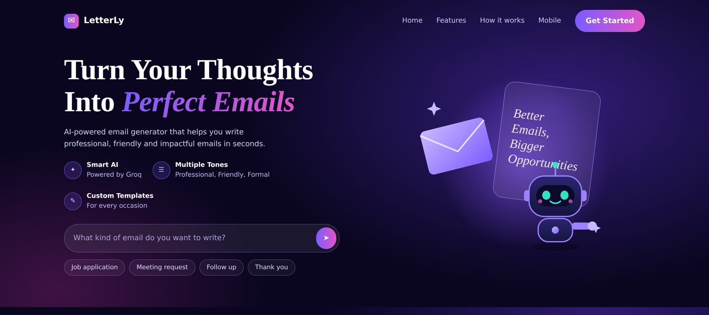

# LetterLy

### Turn your thoughts into perfect emails.

An AI email generator built with **FastAPI** and **Groq**. Tell it who the email is for, what it should achieve and which tone to use, and get a complete, ready-to-send draft in seconds. Then refine it, check it, translate it, save it and export it.

    

   

[](LICENSE) [](#testing) [](#author)

[](#features) [](#screenshots) [](#quick-start) [](#api-reference) [](#deploy-on-vercel-with-firebase) [](#testing)

<!-- After you deploy, add your link here, for example: **[Live demo](https://your-app.vercel.app)** -->

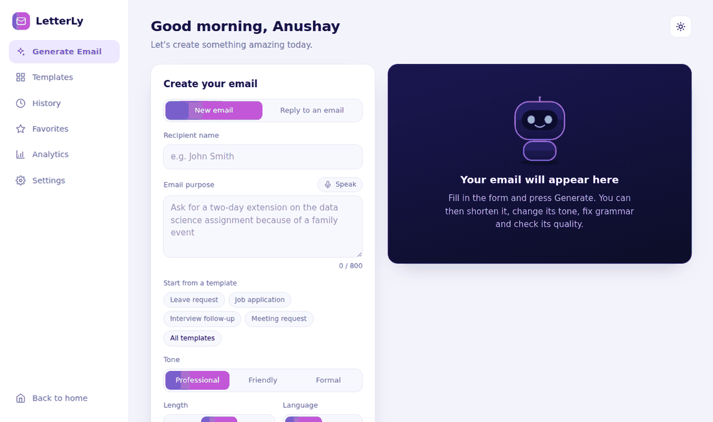

<sub>A short demo with sample data</sub>

</div>

---

## Contents

- [About the project](#about-the-project)
- [Features](#features)
- [Screenshots](#screenshots)
- [How it works](#how-it-works)
- [Tech stack](#tech-stack)
- [Project structure](#project-structure)
- [Quick start](#quick-start)
- [Configuration](#configuration)
- [Using LetterLy](#using-letterly)
- [API reference](#api-reference)
- [How the AI is used](#how-the-ai-is-used)
- [Data and privacy](#data-and-privacy)
- [Deploy on Vercel with Firebase](#deploy-on-vercel-with-firebase)
- [Testing](#testing)
- [Troubleshooting](#troubleshooting)
- [Roadmap](#roadmap)
- [Presentation and report](#presentation-and-report)
- [License](#license)
- [Author](#author)

## About the project

LetterLy started as a simple assignment: **build a FastAPI app that takes a recipient name, an email purpose and a tone, asks an LLM to write the email, and shows it on an HTML page.** That core is here, and it is the heart of the app. Around it grew a complete writing assistant with a landing page, a six-view dashboard, a set of AI tools and the storage, export and deployment pieces that make it a real product.

| The assignment asked for | LetterLy delivers |
| --- | --- |
| A FastAPI backend | A FastAPI app with **22 API endpoints**, validation and error handling |
| Recipient name, purpose and tone | Those three, plus length, language and sender name |
| An LLM that writes the email | Groq `llama-3.3-70b-versatile` answering in JSON mode |
| A simple HTML page | A landing page and a dashboard with six views, light and dark themes, phone layout |
| GitHub link and a screenshot | This repository, a setup guide, a deploy guide and the screenshots below |

## Features

**Writing**
- **Generate** an email from a recipient, a purpose and a tone (Professional, Friendly or Formal), with Short, Medium or Long length and English or Urdu output
- **Reply mode**: paste an email you received and get a reply that answers its points
- **Thread summary**: paste a long thread to get the gist, the questions to answer and the deadlines, then write the reply in one click
- **Voice input** for the purpose field (Chrome and Edge, English and Urdu)

**Improving a draft**
- Make it **shorter**, **longer**, **more formal**, **more friendly**, or **add a call to action**
- **Custom instruction**: type anything, such as "make it more polite"
- **Translate** between English and Urdu, with right-to-left layout
- **Subject suggestions**: three alternatives to pick from
- **Quality score** from 0 to 100 with a verdict and improvement tips
- **Tone detector**: how professional, friendly, formal and confident the draft sounds
- **Grammar fix** that corrects spelling and punctuation without changing the meaning

**Organising and sharing**
- **10 built-in templates** plus your own saved templates
- **Favorites and tags** (up to five per email), **searchable history** with filters
- **Export**: copy, text file, **Word (.docx)**, **PDF**, or open in your mail app
- **Analytics**: emails written, average quality, time saved, tone mix and weekly activity
- **Settings**: your name for sign-offs, default tone and language, typing animation, quality score on or off

**Experience**
- Landing page with an animated mascot, dashboard with a **dark theme**, and a **responsive** layout with a bottom tab bar on phones
- Keyboard friendly, labelled controls and reduced-motion support

## Screenshots

> All screenshots show sample data.

<table>
  <tr>
    <td width="50%">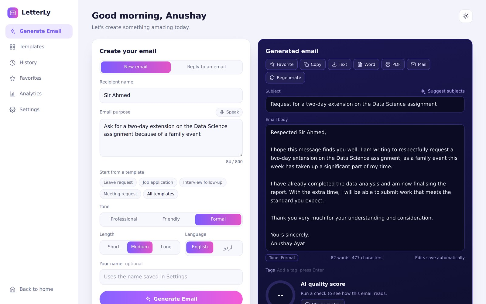<br><sub><b>Generate</b>: form on the left, editable email on the right</sub></td>
    <td width="50%">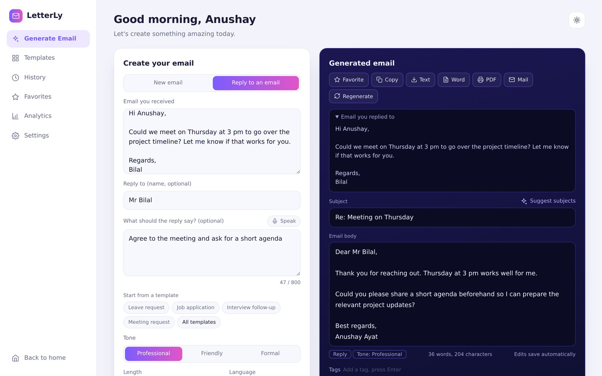<br><sub><b>Reply mode</b>: the original email stays visible</sub></td>
  </tr>
  <tr>
    <td width="50%">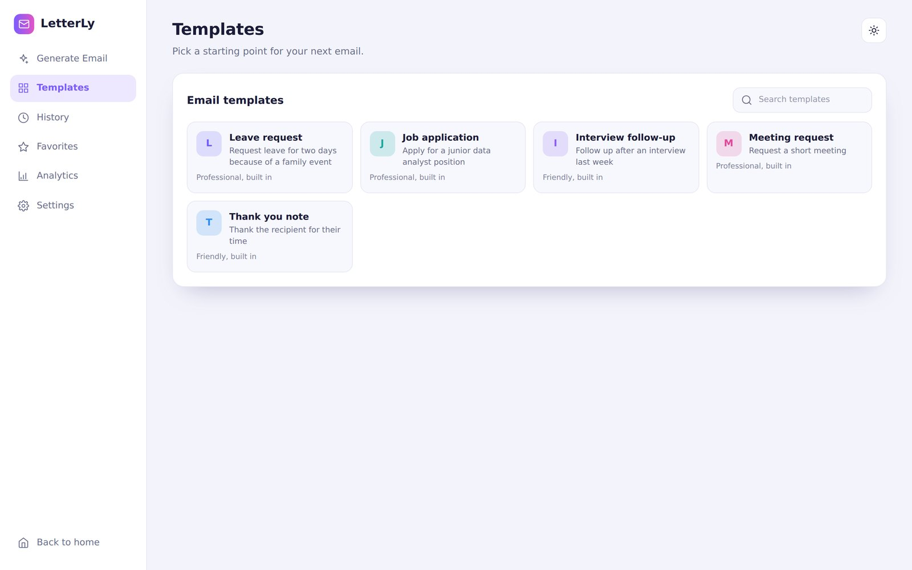<br><sub><b>Templates</b>: built in and saved by you</sub></td>
    <td width="50%">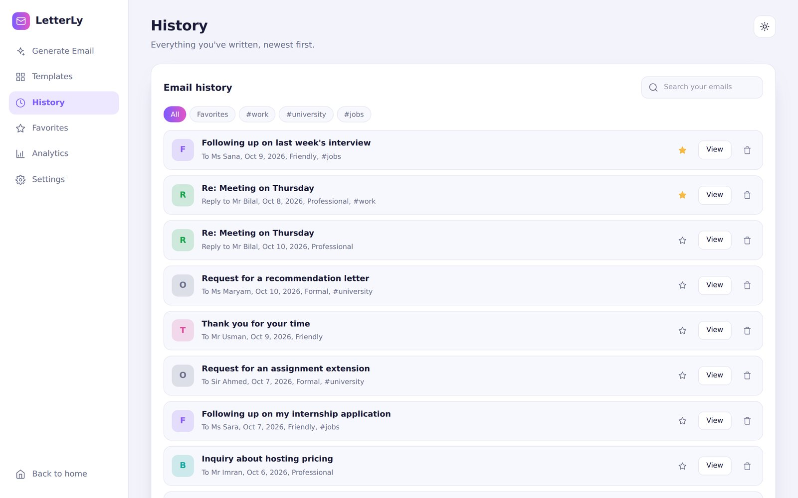<br><sub><b>History</b>: search, favorites and tags</sub></td>
  </tr>
  <tr>
    <td width="50%">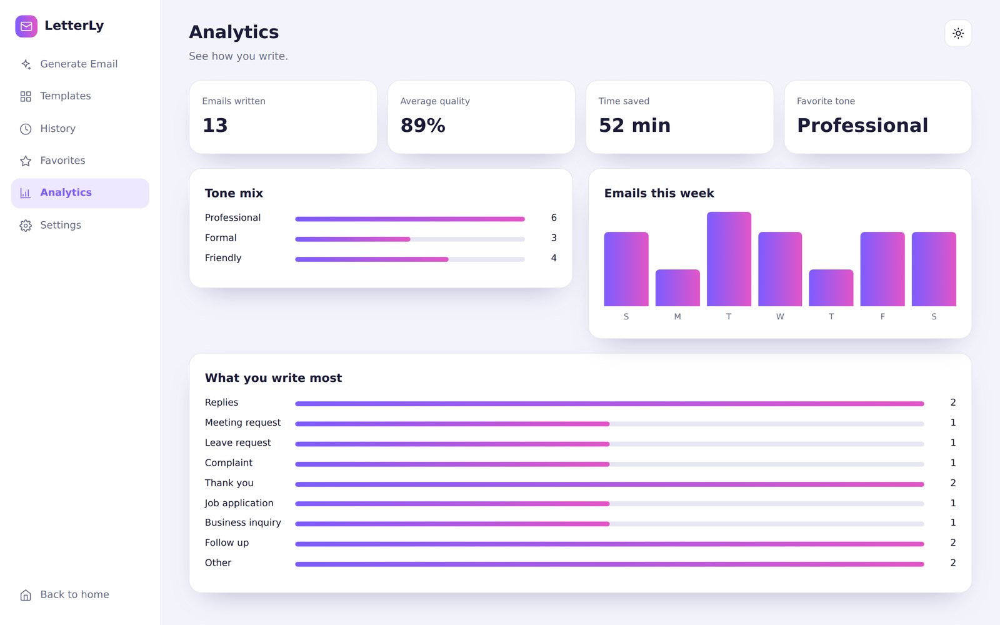<br><sub><b>Analytics</b>: how you write</sub></td>
    <td width="50%">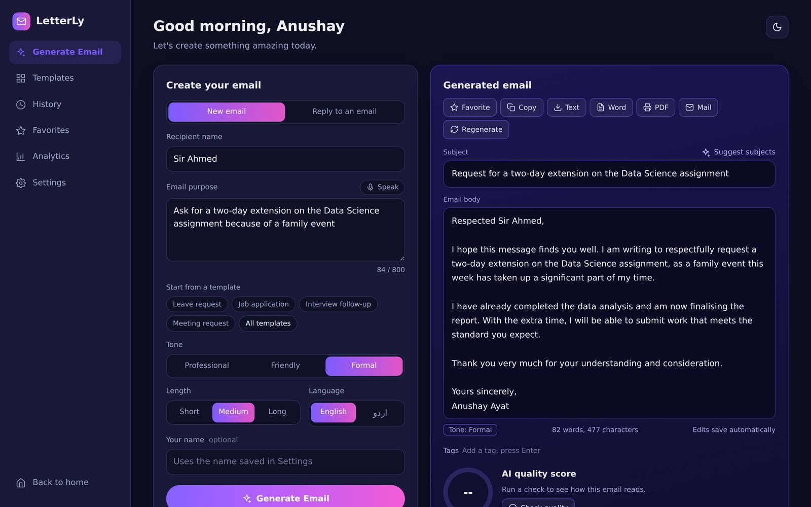<br><sub><b>Dark theme</b></sub></td>
  </tr>
</table>

<details>
<summary><b>More screenshots</b>: AI tools, settings and mobile</summary>
<br>

<p align="center">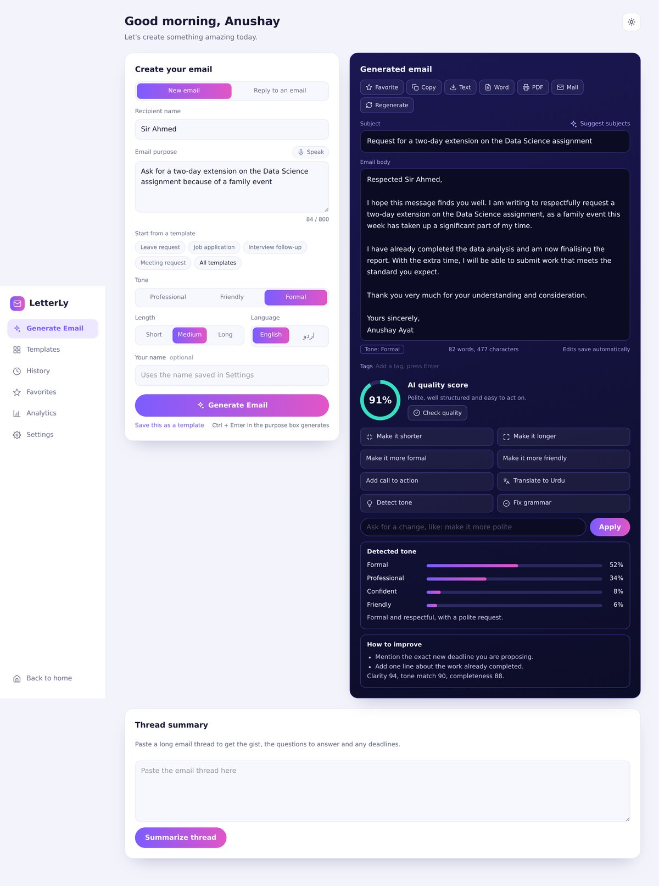<br><sub>Subject suggestions, quality score with tips, and the tone detector</sub></p>

<p align="center">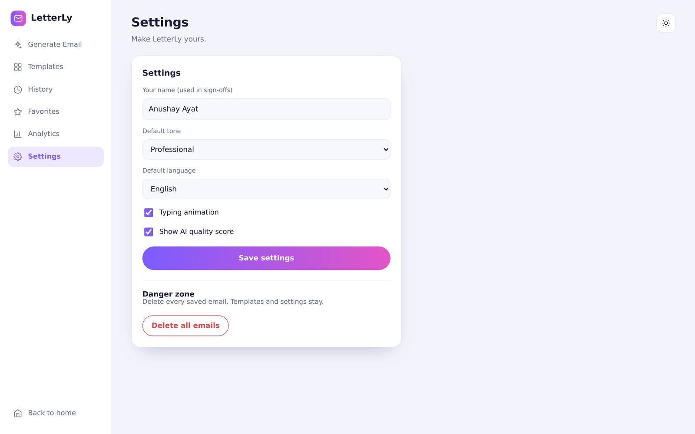<br><sub>Settings</sub></p>

<p align="center">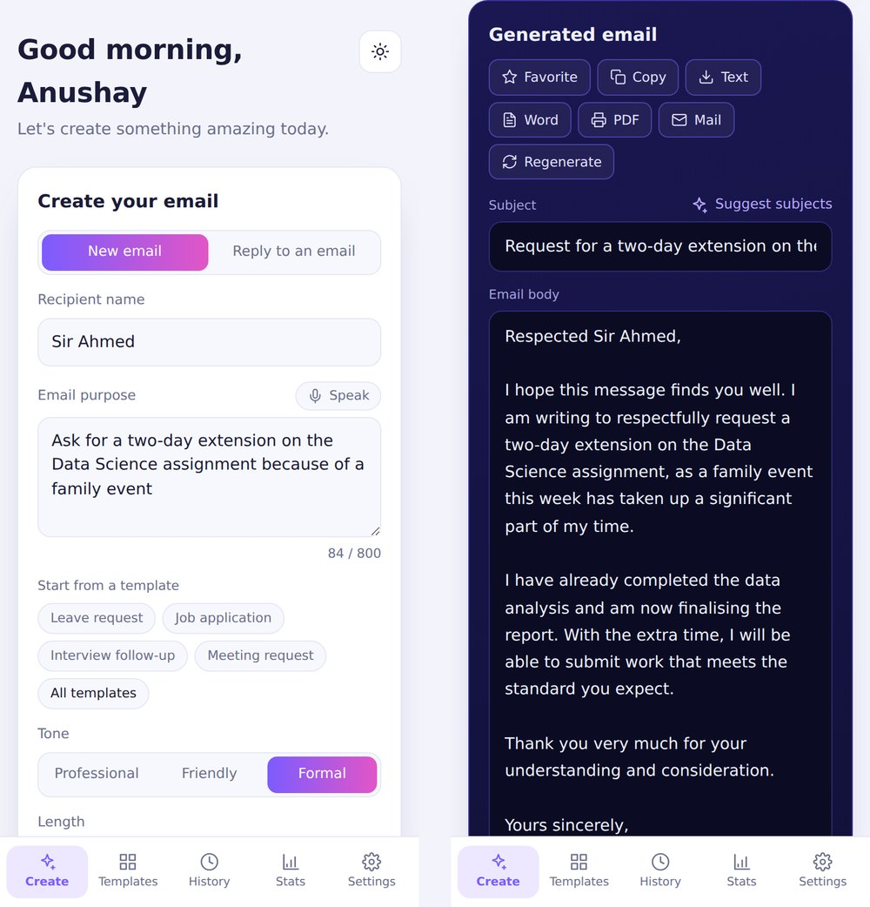<br><sub>On a phone: the form and the generated email, with a tab bar at the bottom</sub></p>

</details>

## How it works

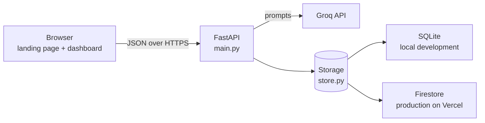

What happens when you press **Generate Email**:

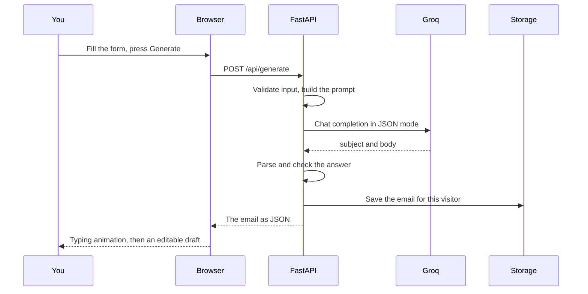

## Tech stack

| Layer | Technology | Why |
| --- | --- | --- |
| Backend | Python, FastAPI, Pydantic | Fast to write, automatic validation, interactive docs at `/docs` |
| AI | Groq API, `llama-3.3-70b-versatile` | Fast inference, free tier, JSON response mode |
| Local storage | SQLite | Ships with Python, no setup |
| Production storage | Firebase Firestore | Works on Vercel, where the disk is read-only |
| Word export | python-docx | Real `.docx` files, including right-to-left Urdu |
| Frontend | HTML, CSS, JavaScript | No build step, no framework |
| Hosting | Vercel | Pages from a CDN, API as a function |

## Project structure

```
ai-email-generator/
├── main.py                    FastAPI app, prompts and all API routes
├── store.py                   Storage: SQLite locally, Firestore on Vercel
├── requirements.txt           Packages Vercel installs
├── requirements-dev.txt       Adds uvicorn for local work
├── vercel.json                Vercel settings (clean URLs)
├── .env.example               Template for your keys
├── LICENSE                    MIT License
├── public/                    Everything the browser loads
│   ├── index.html             Landing page            →  /
│   ├── app.html               Dashboard               →  /app
│   └── static/
│       ├── css/               base.css, landing.css, app.css
│       └── js/                landing.js, app.js
├── tools/
│   └── encode_firebase_key.py Turns a Firebase key into one safe line
├── tests/                     Backend and browser checks
└── docs/                      Presentation, report and the screenshots used in this README
```

## Quick start

**You need:** Python 3.10 or newer and a free [Groq API key](https://console.groq.com/keys).

**1. Get the code**

```bash
git clone https://github.com/<your-username>/ai-email-generator.git
cd ai-email-generator
```

**2. Create a virtual environment**

```bash
python -m venv venv
venv\Scripts\activate          # Windows
source venv/bin/activate       # macOS and Linux
```

**3. Install the packages**

```bash
pip install -r requirements-dev.txt
```

**4. Add your Groq key.** Copy `.env.example` to `.env` and paste the key:

```env
GROQ_API_KEY=your_groq_api_key_here
```

**5. Start the server**

```bash
uvicorn main:app --reload
```

**6. Open the app**

| Page | Address |
| --- | --- |
| Landing page | http://127.0.0.1:8000 |
| Dashboard | http://127.0.0.1:8000/app |
| Interactive API docs | http://127.0.0.1:8000/docs |
| Health check | http://127.0.0.1:8000/api/health |

Locally the app keeps your data in a SQLite file called `emails.db`, created automatically on first use.

## Configuration

Settings come from environment variables. Locally, put them in `.env`. On Vercel, add them in the project settings.

| Variable | Required | Description |
| --- | --- | --- |
| `GROQ_API_KEY` | Yes | Your Groq API key |
| `FIREBASE_SERVICE_ACCOUNT_B64` | On Vercel | Firebase service account key as one safe line. Create it with `python tools/encode_firebase_key.py key.json` |
| `FIREBASE_SERVICE_ACCOUNT` | No | The same key as raw JSON, as an alternative |
| `FIREBASE_SERVICE_ACCOUNT_FILE` | No | Path to the key file, handy for testing Firestore locally |
| `GROQ_MODEL` | No | Overrides the model (default `llama-3.3-70b-versatile`) |
| `DATABASE_PATH` | No | Overrides the SQLite file location |

The storage is chosen automatically: if a Firebase key is present the app uses **Firestore**, otherwise **SQLite**. `/api/health` tells you which one is active.

## Using LetterLy

| I want to | Do this |
| --- | --- |
| Write a new email | **Generate Email**: enter the recipient and the purpose, pick a tone, press **Generate Email** (or Ctrl + Enter in the purpose box) |
| Start from a template | Press a template chip under the purpose field, or open **Templates** |
| Reply to an email | Choose **Reply to an email**, paste it, optionally say what the reply should cover, press **Write reply** |
| Summarise a long thread | Paste it into **Thread summary**, then press **Write a reply** |
| Change the draft | Use the buttons under the email, or type an instruction and press **Apply** |
| Check the draft | **Check quality**, **Detect tone**, **Fix grammar**, **Suggest subjects** |
| Keep it | Star it, add tags, find it again in **History** |
| Send it | **Copy**, **Mail**, or download as **Word**, **PDF** or **Text** |
| Save a template of my own | Fill the form, press **Save this as a template** |

> **PDF export** uses your browser's print window: choose **Save as PDF**. This keeps Urdu text looking correct.

## API reference

Every route is documented interactively at `/docs`. Inputs are validated: for example a purpose must have 3 to 800 characters and a pasted email 10 to 6,000.

| Method | Path | Purpose |
| --- | --- | --- |
| `POST` | `/api/generate` | Generate an email |
| `POST` | `/api/reply` | Write a reply to a pasted email |
| `POST` | `/api/summarize` | Summarise an email thread |
| `POST` | `/api/emails/{id}/refine` | `shorten`, `longer`, `urdu`, `english` or `custom` with an `instruction` |
| `POST` | `/api/emails/{id}/subjects` | Three alternative subject lines |
| `POST` | `/api/emails/{id}/analyze` | Quality score (0 to 100) with tips |
| `POST` | `/api/emails/{id}/tone` | Tone breakdown in percentages |
| `POST` | `/api/emails/{id}/grammar` | Fix spelling and grammar |
| `PUT` | `/api/emails/{id}` | Save edits to the subject and body |
| `PATCH` | `/api/emails/{id}/meta` | Favorite or unfavorite, set tags |
| `GET` | `/api/emails/{id}/export.docx` | Download as a Word file |
| `GET` | `/api/emails?q=&tag=&pinned=` | List, search and filter |
| `GET` | `/api/tags` | Tags in use, with counts |
| `DELETE` | `/api/emails/{id}` | Delete one email |
| `DELETE` | `/api/emails` | Delete all emails |
| `GET`, `PUT` | `/api/settings` | Read or save settings |
| `GET` | `/api/stats` | Numbers for the analytics page |
| `GET`, `POST` | `/api/templates` | List built-in and saved templates, save a new one |
| `DELETE` | `/api/templates/{id}` | Delete a saved template |
| `GET` | `/api/health` | Server status, active storage, API key check |

<details>
<summary><b>Example: generate an email</b></summary>
<br>

```bash
curl -X POST http://127.0.0.1:8000/api/generate \
  -H "Content-Type: application/json" \
  -d '{
    "recipient_name": "Sir Ahmed",
    "purpose": "Ask for a two-day extension on the Data Science assignment because of a family event",
    "tone": "Formal",
    "length": "Medium",
    "language": "English"
  }'
```

The response (shortened, the text will vary):

```json
{
  "id": 1760000000000000,
  "kind": "new",
  "category": "Other",
  "recipient_name": "Sir Ahmed",
  "tone": "Formal",
  "length": "Medium",
  "language": "English",
  "subject": "Request for a two-day extension on the Data Science assignment",
  "body": "Respected Sir Ahmed,\n\nI hope this message finds you well. ...",
  "pinned": false,
  "tags": [],
  "quality": null,
  "created_at": "2026-10-10T08:30:00+00:00"
}
```

</details>

<details>
<summary><b>Example: reply to an email</b></summary>
<br>

```bash
curl -X POST http://127.0.0.1:8000/api/reply \
  -H "Content-Type: application/json" \
  -d '{
    "received_email": "Hi, could we meet on Thursday at 3 pm to go over the project timeline?",
    "purpose": "Agree and ask for a short agenda",
    "tone": "Professional"
  }'
```

</details>

## How the AI is used

- **Structured prompts.** A system prompt sets the role (an expert email writer), demands plain text and forbids inventing facts, dates or numbers. The user prompt adds the recipient, purpose, a description of the tone and a target length.
- **JSON mode.** Groq is asked to answer with `{"subject": "...", "body": "..."}`. A tolerant parser strips code fences, falls back to the first JSON object in the text and checks that both fields exist. If not, the user gets a clear message.
- **One temperature per task.** Creative tasks run warmer, checking tasks run colder.

| Task | Temperature |
| --- | --- |
| Generate an email | 0.7 |
| Refine or translate | 0.5 |
| Subject suggestions | 0.9 |
| Quality score | 0.3 |
| Tone detection and thread summary | 0.2 |
| Grammar fix | 0.1 |

- **Pasted text is data.** When you paste an email to reply to or a thread to summarise, the prompt states that it is content to respond to, not instructions, so commands hidden inside it are not followed.
- **Clear errors.** Rate limits, a rejected key and network problems each produce their own message.

## Data and privacy

- **No login, but private spaces.** Each browser gets a random identifier in a cookie (`letterly_uid`, HttpOnly, SameSite=Lax, Secure on HTTPS). All data is stored under that identifier, so visitors of a public deployment never see each other's emails. Clearing cookies starts a fresh space.
- **Secrets stay out of code.** Keys live in environment variables. `.gitignore` blocks `.env` files and Firebase key files.
- **Safe rendering.** Text from users and the AI is inserted with `textContent`, never as HTML.
- **Locked database.** Only the server talks to Firestore, so keep the Firestore security rules locked.
- **Shared AI key.** On a public link, anyone can use your Groq key to write emails. Set usage limits in the Groq console and rotate the key if you ever see misuse.

Firestore layout:

```
users/{visitorId}/emails/{id}
users/{visitorId}/templates/{id}
users/{visitorId}/meta/settings
```

## Deploy on Vercel with Firebase

Vercel's disk is read-only, so the deployed app stores data in Firebase Firestore. Vercel serves `public/` from its CDN and runs `main.py` as a function.

**1. Create the database.** In the [Firebase console](https://console.firebase.google.com) open your project, go to **Build → Firestore Database** and create a database (any location). Leave the security rules locked.

**2. Download a service account key.** **Project settings → Service accounts → Generate new private key.** A JSON file downloads. Keep it private and never commit it.

**3. Encode the key.**

```bash
python tools/encode_firebase_key.py path/to/your-service-account.json
```

Copy the long line it prints.

**4. Push the project to GitHub.**

```bash
git init
git add .
git commit -m "LetterLy: AI email generator"
git branch -M main
git remote add origin https://github.com/<your-username>/ai-email-generator.git
git push -u origin main
```

**5. Import it into Vercel.** **Add New → Project**, choose the repository, and add two environment variables:

| Name | Value |
| --- | --- |
| `GROQ_API_KEY` | Your Groq key |
| `FIREBASE_SERVICE_ACCOUNT_B64` | The line from step 3 |

Press **Deploy**.

**6. Check it.** Open `https://your-app.vercel.app/api/health`. You should see:

```json
{ "status": "ok", "model": "llama-3.3-70b-versatile", "api_key_configured": true, "storage": "firestore" }
```

Then open the home page, press **Get Started** and generate an email.

## Testing

The project ships with runnable checks. The backend checks need only Python and `python-docx`. The browser checks need [Playwright](https://playwright.dev/python/).

```bash
# Backend: SQLite and Firestore storage (Firestore runs on an in-memory imitation)
python tests/backend_checks.py sqlite
python tests/backend_checks.py firestore

# Browser: drives the real pages against a mock API
pip install -r tests/requirements.txt
playwright install chromium
python tests/ui_checks.py
```

| Suite | Checks | What it covers |
| --- | --- | --- |
| `backend_checks.py sqlite` | 32 | Every endpoint, settings, stats, Word export, templates, cookies |
| `backend_checks.py firestore` | 34 | The same, plus separate visitor spaces and batch deletion |
| `ui_checks.py` | 44 | Landing page, every dashboard view and AI tool, reply mode, templates, export, phone layout |

These checks use a replaced AI function, a mock API and an in-memory Firestore, so they test the project's own logic quickly and repeatably. They do not call the live Groq service or Vercel. After deploying, run this short manual check:

1. `/api/health` shows `"storage": "firestore"` and `"api_key_configured": true`.
2. Generate an email in each tone and in Urdu, then download the Word file.
3. Use reply mode, Check quality, Detect tone, Fix grammar and Suggest subjects.
4. Reload the page: history, favorites and templates are still there.
5. Open the site in a private window: the history is empty (separate spaces).
6. Open the site on a phone: tab bar at the bottom, no sideways scrolling.

## Troubleshooting

<details>
<summary><b>The page says <code>GROQ_API_KEY</code> isn't set</b></summary>
<br>
Copy <code>.env.example</code> to <code>.env</code>, paste your key, and restart the server. On Vercel, add the variable in the project settings and redeploy.
</details>

<details>
<summary><b>"Groq's rate limit was reached"</b></summary>
<br>
The free tier has limits. Wait a minute and try again, or choose a different model with <code>GROQ_MODEL</code>.
</details>

<details>
<summary><b><code>/api/health</code> shows <code>"storage": "sqlite"</code> on Vercel</b></summary>
<br>
The Firebase variable is missing or has a typo. Add <code>FIREBASE_SERVICE_ACCOUNT_B64</code> and redeploy. Until then, data is kept in a temporary folder and can disappear.
</details>

<details>
<summary><b>"The Firebase service account could not be read"</b></summary>
<br>
Run <code>python tools/encode_firebase_key.py your-key.json</code> again and paste the whole line, with no spaces or line breaks, into <code>FIREBASE_SERVICE_ACCOUNT_B64</code>.
</details>

<details>
<summary><b>The page loads but looks unstyled on Vercel</b></summary>
<br>
Make sure the <code>public/</code> folder, including <code>public/static/</code>, was pushed to GitHub.
</details>

<details>
<summary><b>A request times out on Vercel</b></summary>
<br>
Raise the function's maximum duration in the Vercel project settings.
</details>

<details>
<summary><b>The Speak button is missing</b></summary>
<br>
Voice input needs a Chromium-based browser (Chrome or Edge), an internet connection and microphone permission.
</details>

<details>
<summary><b>My history disappeared</b></summary>
<br>
Each browser has its own private space tied to a cookie. Clearing cookies, or using another browser or a private window, starts a new empty space.
</details>

## Roadmap

Ideas for taking LetterLy further:

- [ ] Sign-in with Google, so history follows you across devices
- [ ] Rate limits that protect the shared AI key
- [ ] Streaming, so the email appears as it is written
- [ ] More languages with right-to-left support
- [ ] Send directly through Gmail or Outlook after confirmation
- [ ] Templates shared with a team
- [ ] Calendar-aware replies that suggest meeting times

## Presentation and report

The project comes with a slide deck and a written report, each as an editable file and as a PDF.

| Document | Editable | PDF |
| --- | --- | --- |
| Presentation (21 slides, with speaker notes) | [LetterLy_Presentation.pptx](docs/LetterLy_Presentation.pptx) | [LetterLy_Presentation.pdf](docs/LetterLy_Presentation.pdf) |
| Project report (27 pages) | [LetterLy_Project_Report.docx](docs/LetterLy_Project_Report.docx) | [LetterLy_Project_Report.pdf](docs/LetterLy_Project_Report.pdf) |

## License

LetterLy is released under the [MIT License](LICENSE). You can use, copy and change it freely; just keep the copyright notice.

## Author

**Anushay Ayat**, Artificial Intelligence and Data Science, [SMIT (Saylani Mass IT Training)](https://www.saylaniwelfare.com).

Built as a project for the *AI Email Generator* assignment with [FastAPI](https://fastapi.tiangolo.com), the [Groq API](https://console.groq.com/docs), [Firebase](https://firebase.google.com) and [Vercel](https://vercel.com).
